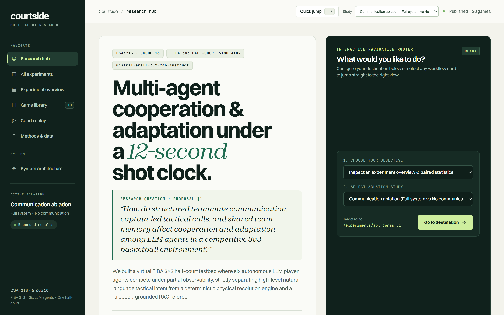
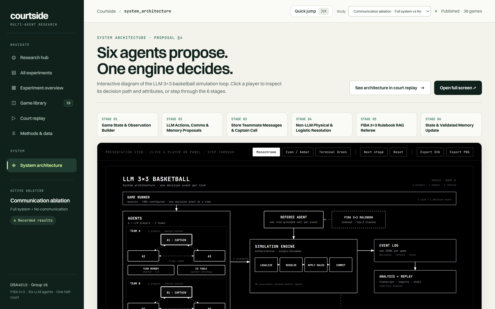
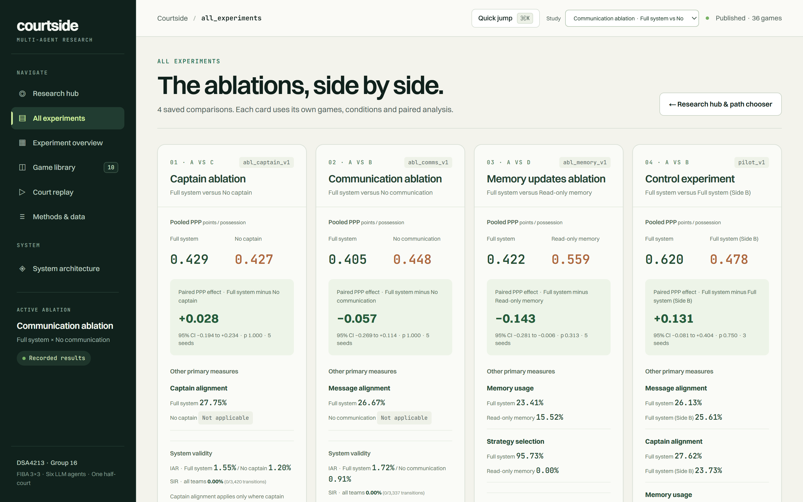
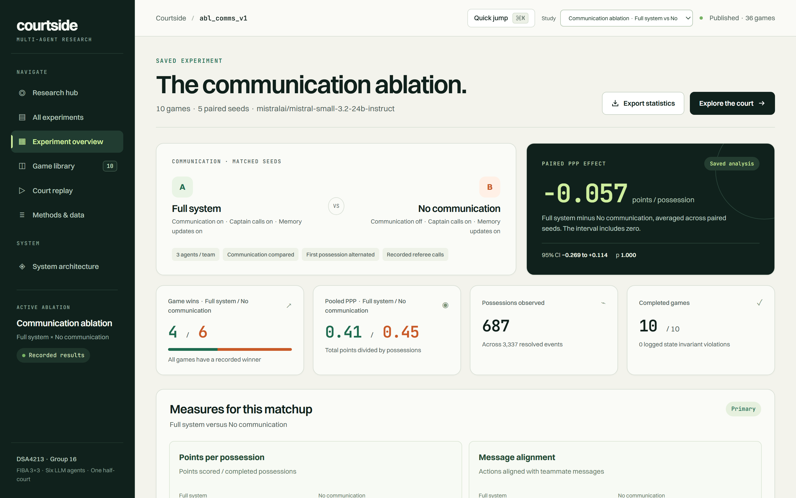
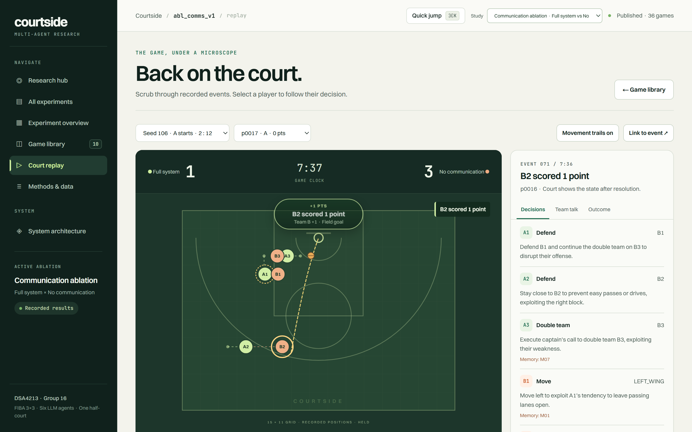

# LLM 3×3 Basketball Agents

Six LLM players. One deterministic engine. One rulebook-grounded referee.

**DSA4213 Natural Language Processing · Group 16**



## Pick where to start

| I want to… | Go to | Time |
|---|---|---|
| See the results without installing anything | [§6 Experiments and results](#6-experiments-and-results) | 2 min |
| Run one game end to end | [§2 Quickstart](#2-quickstart) | ~15 min |
| Re-run an ablation study | [§7 Commands](#7-command-reference) | ~$5 in model spend |
| Read the design reasoning | [`proposal/`](proposal/) | 30 min |
| Understand the simulation engine | [`src/bball3x3/engine/README.md`](src/bball3x3/engine/README.md) | 20 min |

Everything below is either a table or a numbered step. Nothing requires reading in order.

---

## 1. What this is

A research testbed for **multi-agent cooperation and adaptation** in competitive
FIBA 3×3 basketball.

The research question:

> How do structured teammate communication, captain-led tactical calls, and shared
> team memory affect cooperation and adaptation among LLM agents in a competitive
> 3v3 basketball environment?

The design decision that shapes everything: **LLMs only propose intent.** Six LLM
agents emit a natural-language action proposal each tick. A single-threaded,
seeded, non-LLM engine resolves every physical outcome — shots, passes, drives,
rebounds, fouls, fatigue, clock — and commits the next state. No LLM decides
whether a shot goes in. This makes runs reproducible (same seed, same game),
cheap to audit, and immune to a hallucinated score.

Three subsystems sit on top of that base:

| Subsystem | What it does |
|---|---|
| **Coordination** | Teammate messages, a captain who issues tactic calls as directives, and shared team memory with similarity merging |
| **Referee** | Retrieves the top-3 relevant clauses from the indexed FIBA 3×3 rulebook (RAG) and grounds each foul/violation judgement in them |
| **Analysis** | Possession reconstruction, 9 metrics, paired-seed statistics, adaptation plots, replay |



---

## 2. Quickstart

Prerequisites: **Python 3.11+**, [uv](https://docs.astral.sh/uv/) (recommended) or
`pip`, and an [OpenRouter](https://openrouter.ai/keys) API key.

### 1. Install — 2 min

```bash
uv venv
uv sync --extra dev --extra rag
```

<details>
<summary>Without uv</summary>

```bash
python -m venv .venv
.venv\Scripts\activate          # Windows
source .venv/bin/activate       # macOS / Linux
pip install -e ".[dev,rag]"
```
</details>

`rag` is only needed to build or query the rulebook index. Everything else runs
without it.

### 2. Add your API key — 1 min

Create `.env` in the repository root:

```
OPENROUTER_API_KEY=sk-or-v1-...
```

`.env` is gitignored. The CLI loads it automatically; `configs/llm.yaml` names the
variable via `provider.api_key_env`.

### 3. Check the rulebook index — 3 min, one time

The PDF and its index are already committed, so this is optional. Run it only if
you replace the PDF or change the embedding model:

```bash
uv run --extra rag bball build-index
```

Verify the committed index is intact:

```bash
uv run --extra rag python scripts/validate_referee_retrieval.py
```

### 4. Play one game — ~3 min, ~$0.50

```bash
uv run --extra rag python -m bball3x3.runner.game \
  --llm-config configs/llm.yaml \
  --rule-index-dir data/rules \
  --seed 101 \
  --path runs/demo/game.jsonl
```

Writes one JSONL log: every decision, message, captain call, referee ruling and
state snapshot.

### 5. Read what happened — 10 s

```bash
# human-readable transcript of one possession
uv run bball transcript runs/demo/game.jsonl p0001

# tables, then statistics, then plots (each needs a directory that does not exist yet)
uv run bball export runs/demo-export runs/demo/game.jsonl
uv run bball stats  runs/demo-export runs/demo-stats.json
uv run bball plots  runs/demo-export runs/demo-plots
```

### 6. Open the dashboard — 3 min

```bash
cd frontend
npm install
npm run build      # also rebuilds public/data from ../results/*.zip
npm run start      # http://localhost:3000
```

---

## 3. Repository map

| Path | What lives there |
|---|---|
| `src/bball3x3/engine/` | Deterministic simulation: court, clock, actions, resolvers, FIBA rules, 20 invariants. **Has its own [README](src/bball3x3/engine/README.md).** |
| `src/bball3x3/agents/` | Observation builder, Jinja prompts, XML parsing, action legalisation, heuristic + random baselines |
| `src/bball3x3/llm/` | OpenRouter client, retries, repair passes, budget caps, disk cache, fake policies for tests |
| `src/bball3x3/coordination/` | Captain tactic calls, message channels, shared coordination store |
| `src/bball3x3/memory/` | Personal memory, shared memory, embeddings, similarity merging, counter-strategy store |
| `src/bball3x3/referee/` | Rulebook indexer, retriever, rule-based referee, LLM referee, validation suites |
| `src/bball3x3/runner/` | `game.py` (one logged game), `experiment.py` (seeded paired runs), `llm_game.py` |
| `src/bball3x3/analysis/` | Log reading, possessions, metrics, exports, statistics, plots, transcripts |
| `src/bball3x3/schemas/` | Frozen Pydantic records — state, actions, logs, messages, referee, memory |
| `configs/` | `llm.yaml` (models, budget), `simulation.yaml` (every physics coefficient), `experiments/*.yaml`, `teams/*.yaml` |
| `data/rules/` | FIBA 3×3 rulebook PDF + 95 indexed clauses + 384-dim embeddings + manifest |
| `tests/` | 58 files, 522 tests |
| `frontend/` | "Courtside" Next.js 15 dashboard: comparisons, game library, court replay, architecture page |
| `results/` | Source-of-truth result archives (compressed game logs + exports) |
| `runs/` | Where **new** experiments write. Empty by design. |
| `scripts/` | Validation and build helpers (see [§7](#7-command-reference)) |
| `proposal/` | Project proposal, system architecture page, workstream design docs |
| `archive/` | Historical scripts and pre-integration logs — see [§10](#10-documentation-and-archive) |
| `docs/screenshots/` | The images in this README |

---

## 4. How a game runs

One tick = one decision event. Six stages per tick:

| Stage | What happens | Code |
|---|---|---|
| 01 | Build one observation per player (positions, clock, scores, legal actions, recent messages) | `agents/observation.py` |
| 02 | Six LLM calls in parallel return XML proposals + rationale | `agents/llm_player.py`, `agents/adapter.py` |
| 03 | Store teammate messages; captain issues a tactic call with directives | `coordination/` |
| 04 | Engine legalises proposals, resolves physics, applies FIBA rules, checks invariants, commits | `engine/` |
| 05 | Referee retrieves 3 rulebook clauses and rules FOUL / VIOLATION / NONE | `referee/` |
| 06 | Validated shared-memory update | `memory/` |

Inside stage 04 the engine order is fixed: **LEGALIZE → RESOLVE → APPLY RULES →
COMMIT**, with 20 invariants checked before the commit. Any violation is logged
as a State Inconsistency Rate (SIR) event; in tests it raises.

Invalid proposals never crash the game. They are remapped to a spec-defined
fallback (`HOLD`, `SPOT_UP`, `DEFEND`, `BOX_OUT`) and counted in the Invalid
Action Rate (IAR), with the reason recorded.

Rules implemented: 600 s regulation, 12 s shot clock, first to 21, overtime to
+2, team-foul ladder (7th–9th → 2 FT, 10th+ → 2 FT + possession), automatic
clear behind the arc, 15 × 11 m grid with a 6.75 m arc.

---

## 5. What is measured

| Metric | Definition | Direction |
|---|---|---|
| **PPP** | Points scored / completed possessions | higher |
| **MAAR** — message alignment | Actions aligned with teammate messages | higher |
| **CCAR** — captain alignment | Actions aligned with captain directives | higher |
| **CSSR** — strategy selection | Tactic calls using a valid coordination strategy | higher |
| **MAUR** — memory usage | Decisions referencing shared memory | higher |
| **Grounded MAUR** | Memory references that are actually grounded in context | higher |
| **IAR** — invalid actions | Invalid proposals / all decisions | **lower** |
| **Coordination conflicts** | Same-zone conflicts per team-event | **lower** |
| **SIR** — state inconsistency | Invariant violations / state transitions | **lower** |

Two rules that matter when reading the tables:

1. **Every rate keeps its numerator, denominator and evidence status.** A rate
   that cannot be computed is `not_applicable`, `insufficient_evidence` or
   `incomplete` — never a silent zero.
2. **Paired seeds are the primary inference.** Each seed is played twice with the
   first possession swapped; the two are averaged before a seed-cluster bootstrap
   (95% CI) and a two-sided Wilcoxon test. Possession-level models are
   exploratory only.

---

## 6. Experiments and results

Four studies, **36 games**, **11,750 events**, **2,473 possessions**, **$19.88**
of logged model spend.

| # | Study | A (Full system) | B | Seeds | Games |
|---|---|---|---|---|---|
| 1 | `abl_captain_v1` | comms ✓ captain ✓ memory ✓ | **No captain** | 106–110 | 10 |
| 2 | `abl_comms_v1` | comms ✓ captain ✓ memory ✓ | **No communication** | 106–110 | 10 |
| 3 | `abl_memory_v1` | comms ✓ captain ✓ memory ✓ | **Read-only memory** | 106–110 | 10 |
| 4 | `pilot_v1` | Full system | **Full system (Side B)** — mirror control | 101–103 | 6 |

### Headline numbers

| Study | Pooled PPP (A / B) | Paired effect | 95% CI | p | Wins A/B |
|---|---|---|---|---|---|
| Captain | 0.429 / 0.427 | **+0.028** | −0.194 to +0.234 | 1.000 | 5 / 5 |
| Communication | 0.405 / 0.448 | **−0.057** | −0.269 to +0.114 | 1.000 | 4 / 6 |
| Memory updates | 0.422 / 0.559 | **−0.143** | −0.281 to −0.006 | 0.313 | 2 / 8 |
| Control (mirror) | 0.620 / 0.478 | **+0.131** | −0.081 to +0.404 | 0.750 | 4 / 2 |

**Read this honestly.** No ablation separates from its control at 5%: every
p-value is above 0.05, so none of these is a finding yet. The memory ablation's
interval excludes zero, but its Wilcoxon p is 0.313 — which is what 5 paired
seeds buys you. The mirror control, where both sides run an identical
configuration, produces a +0.131 PPP gap, **larger than any treatment effect
measured here**. That is the single most important number in the table: at this
sample size the noise floor is bigger than the signal.

Mechanism checks did move as designed, which is the useful positive result:

| Check | Full system | Ablated condition |
|---|---|---|
| Captain alignment (CCAR) | 27.8% | not applicable without captain |
| Message alignment (MAAR) | 26.7% | not applicable without comms |
| Memory usage (MAUR) | 23.4% | 15.5% read-only |
| Strategy selection (CSSR) | 95.7% | 0.0% read-only |

System validity was clean across all 36 games — **SIR = 0.00%** (0 violations in
11,750 transitions), with IAR between 0.9% and 2.1%.







### Reproducing these numbers

```bash
uv run --extra rag bball run-experiment configs/experiments/ablation_comms.yaml
uv run bball export runs/abl_comms_v1       results/abl_comms_v1-export
uv run bball stats  results/abl_comms_v1-export results/abl_comms_v1-stats.json
uv run bball plots  results/abl_comms_v1-export results/abl_comms_v1-plots
```

> **Note on seeds.** The YAML files list seeds `101–110`. The reported ablations
> use **106–110 only** (the five seeds with complete A/B pairs); seeds 101–103 are
> the control. Running a config as-is therefore plays 20 games, not the 10
> reported here — filter by seed before comparing.

> **Note on cost.** `configs/llm.yaml` caps spend at `$10.00` per experiment
> (`runtime.budget.max_usd_per_experiment`, line 41). A full 20-game run can
> exceed that; the cap stops the run rather than overspending.

---

## 7. Command reference

### `bball` — installed CLI

| Command | Purpose |
|---|---|
| `bball build-index` | Extract rulebook clauses + embeddings. `--backend hash` for the offline fallback, `--force` to replace |
| `bball run-experiment <config.yaml>` | Play every seed twice with swapped first possession; resumes unfinished games. `--dry-run` lists games without calling a model |
| `bball transcript <log> <possession-id>` | Human-readable possession: observations, messages, calls, actions, rationales, memory refs, referee calls |
| `bball export <new-dir> <log…>` | `games.csv`, `teams.csv`, `possessions.csv`, `manifest.json`. Refuses to overwrite |
| `bball stats <export-dir> <out.json>` | Paired seed bootstrap + Wilcoxon; exploratory possession models |
| `bball plots <export-dir> <new-dir>` | PPP / MAUR / CSSR adaptation curves + manifest |

### `scripts/`

| Script | Purpose |
|---|---|
| `validate_rule_referee.py` | Rule-referee decision accuracy on labelled fixtures (offline) |
| `validate_referee_retrieval.py` | Retrieval hit@3 + category recall on 26 labelled states (offline). Baseline 14/26 → 22/26 after the category audit |
| `prompt_harness.py` | 20 fixed scenarios → prompt-quality report. `--fake` for offline |
| `llm_smoke.py` | One live decision against OpenRouter. `--fake` for offline |
| `model_selection.py` | Short live games per candidate model with a hard spend cap |
| `build_frontend_results.py` | Rebuilds `frontend/results/` from `results/` with a parity check. Called by `npm run sync-results` |

### Changing the model

Two places in **`configs/llm.yaml`**:

- **line 10** — `players.model` — the six players
- **line 24** — `referee.model` — the LLM referee

Both are currently `mistralai/mistral-small-3.2-24b-instruct`. To use the
deterministic referee instead, set `referee.enabled: false` (line 22) or
`referee.backend: rule_based` (line 23).

---

## 8. Tests and lint

```bash
uv run pytest          # 522 tests, ~4 min (includes a 1,000-game fuzz run)
uv run ruff check .
```

Current state: **522 passed**, ruff clean. The suite covers court geometry,
clock, the 20 invariants, resolvers, rules, prompts, XML repair, budget and cache,
retrieval, metrics, statistics, exports, plots, and a frontend parity check.

Live API tests are marked `live` and skipped by default: `uv run pytest -m live`.

---

## 9. AI use declaration

Declared for transparency, in the spirit of the DSA4213 academic-integrity rules.

**LLMs are part of the artefact.** The six player agents and the LLM referee are
the object of study, not a development shortcut. Every experiment calls
`mistralai/mistral-small-3.2-24b-instruct` through OpenRouter; token counts, cost,
latency and raw replies are logged per decision in `runs/`.

**LLMs were used as a development tool.** AI coding assistants were used to draft
and refactor implementation code, write tests, and produce documentation during
this project. All such output was reviewed, run, and accepted or rejected by the
team. The 522-test suite, the invariant checker and the seeded deterministic
engine exist precisely so that generated code can be verified rather than
trusted.

**This README was written with AI assistance** (Hermes Agent, model
`deepseek-v4.1-flash`), including the screenshots, which were captured from the
running dashboard. Every figure quoted in §6 was read programmatically from
`frontend/public/data/comparisons.json`, not from prose or memory.

**Human-owned contributions:** the research question and proposal, the
experimental design (conditions, seeds, paired first-possession design, metric
definitions), the choice and interpretation of the statistical tests, the
simulation and rules specification, and every conclusion drawn in §6 — including
the decision to report the null results plainly.

> **Team action required:** confirm the exact assistant and model list used during
> development before submission. This section names what is verifiable from the
> repository; it does not claim to be the team's complete tool inventory.

---

## 10. Documentation and archive

| Document | Contents |
|---|---|
| [`proposal/DSA4213 Group Project Proposal.pdf`](proposal/DSA4213%20Group%20Project%20Proposal.pdf) | The graded proposal |
| [`proposal/agentic_workflows/IMPLEMENTATION_PLAN.md`](proposal/agentic_workflows/IMPLEMENTATION_PLAN.md) | The WS0–WS7 workstream plan, deliverables and gates |
| [`proposal/agentic_workflows/WS6_LOG_CONTRACT.md`](proposal/agentic_workflows/WS6_LOG_CONTRACT.md) | Every log record and its timing |
| [`proposal/agentic_workflows/WS6_DESCRIPTIVE_METRICS.md`](proposal/agentic_workflows/WS6_DESCRIPTIVE_METRICS.md) | Metric numerators, denominators and evidence statuses |
| [`proposal/agentic_workflows/WS5_RETRIEVAL_AUDIT.md`](proposal/agentic_workflows/WS5_RETRIEVAL_AUDIT.md) | Retrieval baseline, every miss, every mapping correction |
| [`proposal/agentic_workflows/MODEL_SELECTION.md`](proposal/agentic_workflows/MODEL_SELECTION.md) | Why this model, with measured cost and latency |
| [`proposal/agentic_workflows/README_WS4.md`](proposal/agentic_workflows/README_WS4.md) | Coordination and memory design |
| [`archive/README.md`](archive/README.md) | What was archived and why, plus how to restore it |
| [`frontend/README.md`](frontend/README.md) | Dashboard internals and Vercel deployment |

`archive/` holds superseded PRE_WS7 harnesses, the pre-integration notebook and
historical run logs. Nothing in `src/`, `tests/` or `frontend/` imports from it,
so it is safe to delete.

---

## Licence and attribution

Coursework for DSA4213 (National University of Singapore), Group 16. FIBA 3×3
rules text is quoted for referee grounding under academic fair use; see
[`third_party/BASKETWORLD_ATTRIBUTION.md`](third_party/BASKETWORLD_ATTRIBUTION.md)
for third-party attribution.
