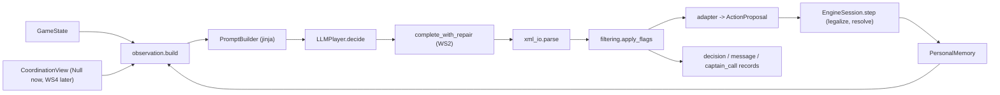

# WS3 Plan — Player Agents, Prompts and Direct XML I/O

**Goal (from [IMPLEMENTATION_PLAN.md §WS3](file:///c:/Users/hongy/OneDrive/Documents/Desktop/llm-3v3-basketball-agents/proposal/IMPLEMENTATION_PLAN.md#L624-L689)):** LLM-vs-LLM games run end to end, with **XML parse failure < 2 %** and **IAR < 5 %** (milestone **M2**, together with WS2). WS3 is on the critical path: WS0 → WS1 → **WS3** → M4 pilot → experiments.

## 0. Decisions (confirmed 2026-10-19)

| # | Decision |
|---|---|
| D1 | Extract `EngineSession.step()` from `loop.py` and build an **async driver**. Heuristic logs must stay byte-identical. |
| D2 | WS3 ships a **minimal t→t+1 message and captain-call delivery** (`SimpleCoordinationView`). WS4 replaces it later through the same interface. |
| D3 | **Follow the proposal:** actions take *teammate / zone / direction* targets. WS1 gets a bounded extension for zone and direction targets (§3.8). |
| D4 | Use a **free OpenRouter model** for now, with low reasoning effort and `max_tokens` around 1,000 (§3.9). |
| D5 | **All 6 players are prompted on loose-ball (rebound) events**, with role `REBOUND`. |
| D6 | Build JSON mode in P1, but **XML stays the default** (`output_format: xml`). |
| D7 | WS3 owns `memory/personal.py` (each agent's personal memory across the game) and the LLM runner path `runner/llm_game.py`. |
| D8 | **Upgraded free tier available (1,000 free requests/day).** Use the free model for WS3 validation, with event-level checkpoint/resume so a full game can span quota windows if needed. |
| D9 | Primary free model is **`google/gemma-4-31b-it:free`**. |
| D10 | **Cleared to implement §3.8 zone/direction targets directly**, guarded by the byte-identical heuristic regression test and 1,000-game random fuzz (`SIR = 0`). |

---

## 1. Where the code stands today

| Area | Status | What it means for WS3 |
|---|---|---|
| Schemas (WS0) | `AgentOutput`, `Message`, `Directive`, `CaptainCall`, `MemoryProposal`, `CSProposal`, `CoordinationConfig` exist ([agent.py](file:///c:/Users/hongy/OneDrive/Documents/Desktop/llm-3v3-basketball-agents/src/bball3x3/schemas/agent.py), [messages.py](file:///c:/Users/hongy/OneDrive/Documents/Desktop/llm-3v3-basketball-agents/src/bball3x3/schemas/messages.py), [memory.py](file:///c:/Users/hongy/OneDrive/Documents/Desktop/llm-3v3-basketball-agents/src/bball3x3/schemas/memory.py)) | The parser's output types are already defined. No schema changes needed. |
| Engine (WS1) | Done. `get_legal_actions`, `validate_action`, `remap_invalid_action` ([actions.py](file:///c:/Users/hongy/OneDrive/Documents/Desktop/llm-3v3-basketball-agents/src/bball3x3/engine/actions.py)); movement and speed labels. | `[LEGAL ACTIONS]` and remapping are ready to use. |
| Game loop | [`play_heuristic_game`](file:///c:/Users/hongy/OneDrive/Documents/Desktop/llm-3v3-basketball-agents/src/bball3x3/engine/loop.py#L68-L536) is **synchronous**: it calls `agent.decide(state)` once per agent, in sequence. | **Gap:** LLM agents are async and must run as 6 parallel calls. The loop needs a seam (§3.6). |
| LLM infra (WS2) | `OpenRouterClient` (semaphore, retries, cache, budget), `complete_with_repair`, and `FakeLLM` are done. | WS3 plugs a parser into `complete_with_repair`. |
| Runner | [`run_logged_game`](file:///c:/Users/hongy/OneDrive/Documents/Desktop/llm-3v3-basketball-agents/src/bball3x3/runner/game.py#L50-L305) logs **heuristic** games only. Decisions use a fake `raw_output`. No message or captain records. | **Gap:** no LLM path. Decisions don't carry observation text, tokens, cost or latency. |
| Log contract (WS6) | `DecisionRecord` already has `observation_text`, `observation_hash`, `tokens`, `cost_usd`, `latency_ms`, and the PARSE_FAIL rules ([log.py](file:///c:/Users/hongy/OneDrive/Documents/Desktop/llm-3v3-basketball-agents/src/bball3x3/schemas/log.py#L223-L297)). | WS3 fills these fields. A final parse failure requires `parsed_output=None` and `invalid_reason="PARSE_FAIL"`. |
| WS4 (comms, captain, memory, CS) | Not started (`coordination/` and `memory/` are empty). | **Gap:** the observation needs these sections. WS3 defines a read interface with null implementations (§3.2). |
| Dependencies | `lxml` and `jinja2` are **not** in [pyproject.toml](file:///c:/Users/hongy/OneDrive/Documents/Desktop/llm-3v3-basketball-agents/pyproject.toml). | Add both. |
| Zone targets | The engine only checks **player** targets. Zone targets on `MOVE`/`CUT`/`SPOT_UP` pass validation but are ignored during movement ([README §4.5](file:///c:/Users/hongy/OneDrive/Documents/Desktop/llm-3v3-basketball-agents/src/bball3x3/engine/README.md#L201-L202)). | Resolved by D3: WS1 extension in §3.8. |
| Player model | `openai/gpt-oss-120b`, `max_tokens: 500`. There is no free variant of it on OpenRouter. | Resolved by D4: switch to a free model (§3.9). |

---

## 2. Scope

**In scope (WS3):**
1. Observation builder: `GameState` → per-agent observation in the Code 1 format.
2. Jinja prompt templates and a builder that hashes the templates.
3. XML parser and renderer, plus the JSON-mode schema and JSON→`AgentOutput` converter.
4. Coordination-flag filtering (marks content as `suppressed`).
5. `LLMPlayer.decide(obs)` with the repair re-ask and a safe fallback.
6. Personal memory: the last ~8 relevant events, built from templates, with no LLM call.
7. Engine seam plus an async LLM game driver, with full decision, message and captain-call logging.
8. FakeLLM policies (valid output plus fault injection) and a prompt harness of about 20 scenarios.

**Out of scope (owned elsewhere):** comms delivery windows, captain-call persistence, shared-memory and CS merging (WS4); the LLM referee (WS5); the experiment runner and seeds × conditions (WS7); metric computation (WS6, which is already done).

---

## 3. Design

### 3.1 Module map

```
src/bball3x3/agents/
├── observation.py      # build_observation(state, pid, ctx) -> Observation ; render_observation(obs) -> str
├── context.py          # CoordinationView protocol + NullCoordinationView (WS4 seam)
├── prompting.py        # PromptBuilder: jinja env (StrictUndefined), messages(), template_hash
├── prompts/
│   ├── system.j2            # role, 3x3 rules summary, action semantics, tag conventions, XML contract + 1 example
│   ├── profile.j2           # Code 2 [PLAYER PROFILE] (6 abilities + playstyle)
│   ├── captain_addendum.j2  # only if captain flag on AND player is captain
│   ├── observation.j2       # Code 1 block
│   └── instruction.j2       # Code 2 [INSTRUCTION], flag-aware
├── xml_io.py           # parse_response, render_response, render_message, JSON schema, json_to_output
├── filtering.py        # apply_flags(output, flags, is_captain) -> (kept, suppressed)
├── llm_player.py       # LLMPlayer.decide(obs) -> DecisionResult
└── adapter.py          # DecisionResult -> ActionProposal ; PARSE_FAIL remap wrapper
src/bball3x3/memory/personal.py   # PersonalMemory (templated, bounded)
src/bball3x3/engine/session.py    # EngineSession.step(proposals) (extracted from loop.py)
src/bball3x3/runner/llm_game.py   # async driver + logging (reuses run_logged_game record assembly)
src/bball3x3/llm/fake_policies.py # LegalXMLPolicy, FaultInjectingPolicy for FakeLLM
scripts/prompt_harness.py         # ~20 fixed scenarios -> report
```



### 3.2 Observation (`observation.py`, `context.py`)

There are two layers. A structured `Observation` (a Pydantic model) is what tests use. `render_observation()` turns it into the exact text shown to the LLM and logged as `observation_text`.

Sections, in order (Code 1 plus the plan's additions):

| Section | Source | Notes |
|---|---|---|
| `[OWN STATE]` | state | Player, Team, **Role** (`BALL_HANDLER / OFF_BALL / DEFENSE / REBOUND`), Position, Has Ball, Fatigue `x/10` |
| `[TEAMMATES]`, `[OPPONENTS]` | state + engine movement labels | Position, Movement, Speed. Optional extra: relational labels such as `TOWARDS_A1`, derived from `prev_pos→pos`. Phase 2 nice-to-have. |
| `[DEFENSIVE MATCHUPS]` | `state.matchups` | `B1 -> A1` |
| `[BALL]` | `state.ball` | Position, Status, Possession |
| `[GAME]` | state | Score, `mm:ss` game clock, shot clock, team fouls, phase, flags `SHOT_CLOCK_LOW` (≤ 3 s), `NEEDS_CLEAR`, `OVERTIME` |
| `[COURT ZONES]` | `court.ZONES` | Static list of zone names with their cells and 1-pt/2-pt value. Moved into the system prompt so it can be cached. |
| `[LEGAL ACTIONS]` | `get_legal_actions` + target spec (§3.8) | Sorted, with target hints, e.g. `PASS (target: A2 \| A3)`, `CUT (target: zone)`, `DRIVE (target: LEFT \| RIGHT \| MIDDLE \| BASELINE)`, `DENY (target: B1 \| B2 \| B3)`. On loose-ball events (D5) every player sees role `REBOUND` and `CRASH_BOARDS / BOX_OUT / GET_BACK / MOVE / HOLD`. |
| `[PREVIOUS CAPTAIN CALL]` | `CoordinationView` | `none` if the captain flag is off or there is no call |
| `[PREVIOUS TEAMMATE MESSAGES]` | `CoordinationView` | `none` if comms are off. **Team B still sees captain directives.** |
| `[PERSONAL MEMORY]` | `PersonalMemory` | Up to 8 lines |
| `[SHARED TEAM MEMORY]` | `CoordinationView` | `M01: B1 — leaves passing lanes open (confidence: 2)` |
| `[COUNTER-STRATEGY TABLE]` | `CoordinationView` | `empty` at the start |

`CoordinationView` protocol (WS4 implements it, WS3 ships `NullCoordinationView` plus a `StaticCoordinationView` for tests):

```python
class CoordinationView(Protocol):
    def captain_call(self, team: str, event_idx: int) -> CaptainCall | None: ...
    def inbox(self, team: str, pid: str, event_idx: int) -> list[Message]: ...
    def shared_memory(self, team: str, event_idx: int) -> list[MemoryEntry]: ...
    def cs_table(self, team: str, event_idx: int) -> list[CSEntry]: ...
```

Disabled sections are rendered as `none` and never removed. This keeps prompt length similar across conditions.

### 3.3 Prompts (`prompting.py`, `prompts/*.j2`)

- **Message layout for prompt caching.** The system message holds the static content: rules, contract, example, profile and captain addendum. It is identical for a given player across the whole game. The user message holds the observation and the instruction.
- **Flag-aware variants.** Comms off: non-captains get no messaging instructions. Captain off: no addendum. Memory write off: the update instruction is removed. The output contract stays the same in every condition.
- **Hashing.** `template_hash = sha256(all template sources + variant key)`. It goes into `game_start.prompt_hashes` and the harness reports. `StrictUndefined` makes a missing variable an error.
- **Defense.** The same templates are used, with defensive legal actions. Defenders also send messages, and captains also make calls on defense.
- **Rationale.** `<RATIONALE>` is requested only if `include_rationale: true`, with a cap of about 25 words.

### 3.4 XML I/O (`xml_io.py`)

Parsing pipeline:
1. Remove code fences. Extract the **first** `<RESPONSE>…</RESPONSE>`. If the closing tag is missing, accept up to the end of the text.
2. Escape stray `&` and `<` inside text nodes, but not inside known tags. Parse with `lxml.etree.XMLParser(recover=True)`.
3. `<ACTION type target memory_ref>`: uppercase and strip the type. `"None"` or empty becomes `None`. `memory_ref` is split on commas.
4. Message children: `<A1>…</A1>` and `<c>` wrappers. Regex for `[action to=.. act=.. target=..] … [/action]` and `[tactic cs=..] … [/tactic|EOL]`, accepting the unclosed variant. A bare `[action]` with no attributes becomes `kind="action"` with `directive=None`. It is not a valid directive for MAAR.
5. Validate IDs and enums against a `ParseContext`: the player, the roster IDs, `ActionType`, `MemoryCategory`, and the current memory IDs and CS keys.

**Error policy.** This separates parse failures from IAR, which matters for honest metrics.

| Problem | Classification | Effect |
|---|---|---|
| No `<RESPONSE>` or no `<ACTION type>` | **Fatal** | Triggers the repair re-ask. If it still fails, the result is `PARSE_FAIL`. |
| Action name not in the vocabulary, illegal action, bad target | **Not a parse error** | Passed to the engine, which logs `UNKNOWN_ACTION`, `ILLEGAL_POSSESSION` or `BAD_TARGET` (IAR). **Never repaired**, so IAR is not hidden. |
| Malformed optional element (bad directive, unknown `memory_ref`, bad category) | **Warning** | The element is dropped (an unknown `memory_ref` is kept but marked invalid for MAUR). The issue goes into `parse_errors` as a `WARN:` entry, and `parse_ok` stays `True`. |

Rendering: `render_response(AgentOutput)` produces canonical XML. In JSON mode, logs and teammates see this. `render_message(Message)` produces the exact teammate view, e.g. `<A2>[action to=A3 act=SCREEN target=B1] … [/action]</A2>`.

JSON mode: a `RESPONSE_JSON_SCHEMA` that mirrors the XML is passed as `response_format`. `json_to_output()` produces the same `AgentOutput`. Everything downstream is identical.

### 3.5 `LLMPlayer` (`llm_player.py`, `adapter.py`, `filtering.py`)

```python
@dataclass
class DecisionResult:
    output: AgentOutput            # parse_ok False => action placeholder
    kept: AgentOutput              # after flag filtering
    suppressed: list[Message]      # + suppressed captain_call / memory / cs flags
    observation_text: str
    raw_attempts: list[str]        # all attempts; final one -> DecisionRecord.raw_output
    responses: list[LLMResponse]   # tokens / cost / latency summed for the record
    prompt_hash: str
```

- `decide(obs)` renders the prompt, calls `complete_with_repair(llm, msgs, params, parse)` (with `response_format` in JSON mode), filters, and returns the result. One decision maps to one `DecisionRecord`, whatever the number of repairs (log contract §3.2).
- **API failure after retries, or `BudgetExceeded`:** the game is aborted as an *incomplete run*. It is **not** recorded as `PARSE_FAIL` (log contract line 116).
- **Adapter:** if parsing failed, a placeholder proposal goes through `remap_invalid_action` and the reason is overwritten with `PARSE_FAIL`. No engine change is needed.
- **Flag filtering:**
  - Comms off: non-captains' `MESSAGES` are dropped, and so are the captain's ordinary messages. `CAPTAIN_CALL` is kept.
  - Captain off: `CAPTAIN_CALL` is dropped, and `[tactic]` lines stay ordinary messages.
  - Memory write off: `MEMORY_UPDATE` and `CS_UPDATE` are dropped.
  - Everything dropped is logged with `suppressed=True`.

### 3.6 Engine seam and async driver

Per D1, extract the body of the `while` loop in `play_heuristic_game` into `EngineSession.step(proposals) -> payload`, which stays synchronous and deterministic. Then:
- `play_heuristic_game` becomes a thin wrapper around `EngineSession`. A **regression test** checks that seeds 7 and 101 produce byte-identical payloads and logs before and after the refactor.
- `runner/llm_game.py::run_llm_game(...)` is async. For each event it builds 6 observations, runs `asyncio.gather` over the decisions, converts them to proposals, calls `session.step`, then logs and updates personal memory.

Logging added on top of the existing record assembly:
- `game_start`: model slug, prompt hashes per variant, coordination flags per team, and the roster captain.
- `decision`: `raw_output` (final attempt), `parsed_output`, `observation_text`, tokens, cost, latency, `memory_ref`.
- `message` and `captain_call`: emitted at event *t* with `delivered_at=t+1`, or `suppressed=True`.
- `game_end.total_cost_usd`.

Until WS4 lands, the driver uses a **minimal in-memory t→t+1 inbox** (`SimpleCoordinationView`), so messages and directives are actually delivered in M2 games. WS4 replaces it with the full windowed implementation (D2).

### 3.7 Personal memory (`memory/personal.py`)

`PersonalMemory(pid, maxlen=8).update(prev, state, payload)` adds a templated line when the player, their matchup, or the ball is involved. Examples:
- `E42: You passed to A2 — completed.`
- `E43: B1 stole the ball from A2.`
- `E45: Your 2-pt shot from (3,9) missed (contested by B2).`
- `E46: Team A scored 1 pt (A3).`

It is deterministic, makes no LLM call, and is reset every game.

### 3.8 WS1 extension: zone and direction targets (D3)

The proposal's action table gives targets as *teammate / zone / direction* (IMPLEMENTATION_PLAN §WS1.2, "Named zones map to cells, so agents can use them as targets"). This extension is bounded and must not change heuristic behaviour.

| Action | Target kind | Engine effect | Invalid target gives |
|---|---|---|---|
| `PASS` | teammate | unchanged | `BAD_TARGET` |
| `SCREEN` | teammate (screen for) or opponent (screen on) | unchanged resolver; screener steps toward the target | `BAD_TARGET` |
| `SWITCH` | teammate | unchanged | `BAD_TARGET` |
| `DOUBLE_TEAM`, `DENY` | opponent | unchanged | `BAD_TARGET` |
| `DEFEND`, `CONTEST`, `STEAL_ATTEMPT` | opponent, optional (default: own matchup) | step toward that player | `BAD_TARGET` |
| `MOVE`, `CUT`, `CUT_BASELINE`, `SPOT_UP`, `POP`, `ROLL`, `GET_BACK` | zone, optional | step toward the zone cell, up to the movement limit for the action's time cost. With no target, the current drift is kept. | Unknown zone gives `BAD_TARGET` |
| `DRIBBLE_MOVE`, `POST_UP` | zone, optional | ball handler steps toward the zone (ball follows) | `BAD_TARGET` |
| `DRIVE` | direction `LEFT \| RIGHT \| MIDDLE \| BASELINE`, optional | the drive path is biased in that direction; the resolver is unchanged | `BAD_TARGET` |
| `SHOOT`, `HOLD`, `CLEAR`, `HELP_PAINT`, `CRASH_BOARDS`, `BOX_OUT` | none | unchanged | A target is ignored and logged as a warning, not marked invalid |

- **Reachability:** a zone that is too far is *not* infeasible. The player moves as far as the limit allows (constraint 9 stays satisfied). This keeps IAR about intent errors, not geometry.
- **Code location:** `engine/actions.py` (`TARGET_SPEC`, plus validation for zones and directions) and `engine/session.py` (zone-directed movement). `ZONES` already exists in `court.py`.
- **Tests:** zone-target movement respects the movement limit; unknown zone gives `BAD_TARGET`; the 1,000-game random fuzz (with zone targets now sampled) stays at SIR = 0; heuristic regression stays byte-identical (heuristic agents send no zone targets).
- **Clearance (D10):** WS3 implements these changes directly under the regression and fuzz guards above.

### 3.9 Model and request settings (D4, D8, D9)

Primary free model: **`google/gemma-4-31b-it:free`** (`nvidia/nemotron-3-super-120b-a12b:free` kept as a secondary option if needed).

| Model | `response_format` (JSON fallback) | Reasoning control | Role |
|---|---|---|---|
| `google/gemma-4-31b-it:free` | yes | yes | **Primary** (D9) |
| `nvidia/nemotron-3-super-120b-a12b:free` | yes | yes | Optional alternate |

Changes:
- `configs/llm.yaml` `players`: `model: google/gemma-4-31b-it:free`, `max_tokens: 1000`, new `reasoning: {effort: low}`.
- WS2 touches:
  1. `LLMPlayersConfig.reasoning: dict[str, Any] | None = None`, forwarded in `extra_body`.
  2. Record `finish_reason: str | None = None` in `LLMResponse`, so truncation (`length`) is visible in the harness and logs.
  3. Client-side **requests-per-minute token bucket** (`runtime.max_requests_per_minute: int | None = 18` for `:free` models) so parallel 6-player bursts respect the ~20 req/min free-tier cap without triggering 429 storms.
  4. Treat `429` responses indicating daily quota exhaustion as **non-retryable** (`QuotaExceededError`), aborting cleanly so the runner can checkpoint and resume later.
  5. Event-level **checkpoint/resume** in `runner/llm_game.py` (+ SQLite LLM cache enabled during pilot/validation runs) so a full ~1,700-call game can pause at the 1,000 req/day boundary and resume seamlessly without losing progress.

---

## 4. Testing

| Level | Tests (all run without an API key) |
|---|---|
| Unit: `xml_io` | Valid full response; minimal response; surrounding prose and code fences; missing `</RESPONSE>`; stray `&`/`<`; unclosed `[tactic]`; bare `[action]`; `<c>` captain wrapper; unknown action passed through (not fatal); bad `memory_ref` gives a warning; render→parse round trip (property test with `hypothesis`); JSON↔XML equivalence |
| Unit: observation | Golden text for Code 1 fixtures (ball handler, off-ball, defender, rebound, needs-clear, OT, shot-clock-low); `none` rendering under each flag; target hints match `validate_action`; no opponent messages ever appear |
| Unit: prompts | Hash stable and changes when a template changes; `StrictUndefined` catches missing variables; variant matrix (4 teams × captain/non-captain × offense/defense) renders |
| Unit: filtering | One test per flag: exactly one information flow changes; Team B captain directives survive |
| Unit: player | FakeLLM bad→good gives a repair and `parse_ok`; bad→bad gives `PARSE_FAIL` + remap + valid `DecisionRecord`; tokens and cost summed; budget exceeded aborts the game |
| Regression | `EngineSession` refactor: heuristic logs byte-identical for fixed seeds |
| Integration | Full game with `LegalXMLPolicy` FakeLLM: logs pass the WS6 strict reader, IAR = 0, PARSE_FAIL = 0. With `FaultInjectingPolicy` (e.g. 10 % malformed): PARSE_FAIL rate matches the injection after repair, and the game completes |
| Live (manual, `-m live`) | `scripts/llm_smoke.py`, extended to one real decision; one short real game (`max_events=40`) |

---

## 5. Prompt harness (`scripts/prompt_harness.py`)

- About 20 fixed scenarios stored as JSON `GameState` plus context fixtures. They cover:
  - open shot; needs-clear; shot clock ≤ 2; off-ball cut opportunity
  - off-ball player who received a captain screen directive
  - on-ball defender facing a drive; help defense
  - rebound phase
  - captain with no prior call; Team B non-captain; Team C; Team D
  - memory present with an exploitable tendency; CS table non-empty
  - OT with the score tied; and so on
- N samples per scenario (default 5, cache off). Reports:
  - parse success before and after repair, and repair rate
  - IAR by reason
  - directive emission rate, and directive-follow rate on injected-directive scenarios
  - `memory_ref` usage; CS usage
  - tokens in/out, cost, p50/p95 latency
- Output goes to `runs/harness/<prompt_hash>/report.{json,md}`, so prompt versions can be compared directly.

---

## 6. Delivery phases

| Phase | Deliverable | Exit check |
|---|---|---|
| **P0** Setup | Add `lxml` and `jinja2`; add `hypothesis` to dev. WS2 touches (`reasoning` passthrough, `finish_reason`, RPM limiter, daily-429 abort). Set `google/gemma-4-31b-it:free` in `llm.yaml`. Live smoke test against the free model. | `uv sync`, CI green, smoke reply parsed |
| **P1** XML/JSON I/O | `xml_io.py` (XML is the main path; JSON schema and converter as the fallback), `filtering.py`, unit tests | Parser test matrix green |
| **P2** Observation + personal memory | `observation.py`, `context.py` (`Null` / `Static` / `SimpleCoordinationView`), `memory/personal.py`, golden texts | Golden texts verified |
| **P3** Prompts | Templates, `PromptBuilder`, variant-matrix tests | All variants render; hash in place |
| **P4** LLMPlayer | `llm_player.py`, `adapter.py`, fake policies | Repair, PARSE_FAIL and budget tests green |
| **P5a** Engine seam (D1) | `engine/session.py`; `play_heuristic_game` becomes a wrapper | Heuristic logs byte-identical for fixed seeds |
| **P5b** Zone/direction targets (D3, D10) | Target spec, validation and zone/direction movement (§3.8) | Fuzz SIR = 0; regression still byte-identical |
| **P5c** Async driver | `runner/llm_game.py`, logging, t→t+1 delivery, checkpoint/resume | FakeLLM full game passes the strict log reader, including message and captain records |
| **P6** Live validation | Harness run on `google/gemma-4-31b-it:free` (~20 scenarios × 3–5 samples), 1 short real game (`max_events=40`), then full M2 game (resumable across the 1,000 req/day window if needed) | **M2:** Parse failure < 2 %, IAR < 5 %, latency/tokens measured |

P1, P2, P3 and P5a can start in parallel. P5b depends on P5a, and P5c depends on P4 and P5a.

**Live spend during WS3:** \$0 (`google/gemma-4-31b-it:free` on the 1,000 req/day upgraded free tier).

---

## 7. Risks

| Risk | Mitigation |
|---|---|
| Free-tier RPM (~20 req/min) or daily cap (1,000/day) throttles full-game runs | Client-side RPM token bucket (`max_requests_per_minute: 18`), SQLite cache on for validation, clean daily-quota abort + event-level resume. |
| Free models change or provider routing shifts | Pin `google/gemma-4-31b-it:free`; `allow_fallbacks: false`; log the model slug per game; keep `nvidia/nemotron-3-super-120b-a12b:free` as backup. |
| Free-model results differ from the final M4 model | Treat WS3 numbers as **engineering validation**; re-run the harness at M4 before freezing prompts. |
| Reasoning tokens truncate the XML | `reasoning.effort: low`, `max_tokens: 1000`, track `finish_reason=length`. |
| The LLM ignores `[LEGAL ACTIONS]` and IAR goes above 5 % | Target hints, role line, one example per role, harness iteration. Never repair to suppress IAR. |
| Zone extension perturbs engine guarantees | Optional targets (no target = old behaviour); byte-identical regression; 1,000-game fuzz SIR = 0. |
| WS4 interfaces drift | `CoordinationView` protocol agreed now; WS4 swaps the implementation. |

