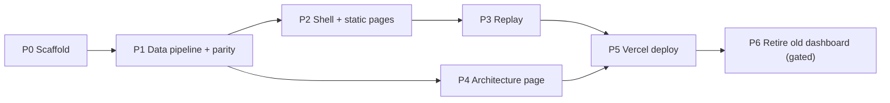

# Frontend Migration Plan — "Courtside" on Vercel

> **Goal:** Replace the Python-served results dashboard (`bball dashboard`) with a self-contained web app in `./frontend`. The app reads the corrected results in `./results` (copied into the frontend), adds the system architecture page, runs locally with `npm run build` + `npm run start`, and deploys to Vercel using `frontend/` as the project root.
>
> **Status:** Plan only. No code has been written yet.

---

## 1. Current state (what exists today)

### 1.1 Existing dashboard (to be replaced)

| Piece | Location | Notes |
|---|---|---|
| Data layer + HTTP server | `src/bball3x3/display/dashboard.py` (446 lines) | `DashboardData` (reads export CSVs, `stats.json`, `plots/adaptation.csv`, JSONL logs), `DashboardCatalog` (discovers `runs/*_results` + `runs/*_runs`), and a `ThreadingHTTPServer` exposing `/api/experiments`, `/api/comparisons`, `/api/experiment`, `/api/games/{id}` and `/downloads/*`. |
| Client | `src/bball3x3/display/web/{index.html, app.js, style.css, replay.css}` | Vanilla JS SPA (about 600 dense lines) with hash routing. Views: `comparisons`, `overview`, `games`, `replay`, `notes`. |
| CLI entry | `src/bball3x3/cli.py` → `bball dashboard` | Documented in `README.md` §"results dashboard and game replay". |
| Tests | `tests/test_dashboard.py` | 7 tests: pooling, overview, replay frames and message timing, bad records, HTTP routing, ambiguous roots, catalog discovery. |
| Old (incorrect) data | `runs/abl_comms_v1_results/`, `runs/abl_comms_v1_runs/` | Comms ablation only. The new app must **not** read these. |

**Logic that must be kept:** The Python data layer encodes research semantics, and the new data pipeline must reproduce them exactly:
- `_pool`: sums valid numerators and denominators, and derives `ok` / `partial` / single-status / `unavailable`.
- `METRICS`, `LABELS`, `FEATURES`, `MATCHUP_MEASURES`: the constants for metric names, condition labels and the primary/context/adaptation measures for each matchup.
- Baseline-first condition ordering. Winner and draw derivation. Games sorted by `(int(seed), first_possession)`.
- Paired effects come from `stats.json` as-is. They are never recomputed.
- Replay frames: frame 0 is `game_start.initial_state`. Every later frame needs a `state` record. Decisions keep only `rationale` and `action` from `parsed_output`. A warning is added when the log has no `game_end` or its score differs from the export.

### 1.2 Corrected results in `./results` (source of truth)

| File(s) | Contents |
|---|---|
| `interim_31games.zip` (0.5 MB) | **Final overall results.** Folder `interim_31games/` holds three experiments: `abl_comms_v1`, `abl_captain_v1`, `abl_memory_v1`. Each has `export/{games,teams,possessions}.csv`, `export/manifest.json`, `stats.json`, `plots/{adaptation.csv, manifest.json, comparison-001-{ppp,maur,cssr}.png}`. The zip root also has a `manifest.mf`. |
| `abl_comms_v1_s101..s106.zip` (6 zips) | Raw JSONL game logs, two per zip (`*_A.jsonl`, `*_B.jsonl`), about 12–13 MB each uncompressed. |
| `abl_captain_v1_s101..s105.zip` (5 zips) | Same format. |
| `abl_memory_v1_s101..s105.zip` (5 zips) | Same format. About 7–8 MB per log. |

Facts found while preparing this plan:
- **31 games in the exports versus 32 logs.** Comms has 11 exported games; `abl_comms_v1_s106_B` has a log but **no export row**. `abl_comms_v1_s106_A` is exported but excluded from the paired statistics (`missing_or_duplicate_start_side`). Captain and memory have 10 games each.
- **All three experiments use model `mistralai/mistral-small-3.2-24b-instruct`.** Each one compares `A_full` against `B_no_comm`, `C_no_captain` or `D_read_only`.
- **The interim zip has an unusual format.** Its directory entries (e.g. `interim_31games/`) have non-zero data lengths. .NET's `ZipFile.ExtractToDirectory` refuses to extract it ("entry name ends in directory separator character but contains data"). `tar` / bsdtar extracts it fine. The JS unzip step must skip entries whose names end in `/`, and this must be tested.
- **Export `source` paths point to another machine** (`/tmp/bball_export/snap/...`). Logs must be matched by `game_id` file name, as the Python code already does.
- **Most of each log is data the dashboard never shows.** Decision records make up about 81% of a log's bytes, mostly `observation_text`, `parsed_output` and `raw_output`. A compacted replay was measured on `abl_comms_v1_s101_B`:
  - Raw log: 13.3 MB
  - Compacted replay JSON: **≈2.0 MB**
  - Gzipped: **≈140 KB**

### 1.3 Architecture page

- `system_architecture.html` (1,341 lines, about 51 KB) is a standalone interactive page. It contains:
  - Inline `<style>` and `<script>` with global functions (`setTheme`, `stepForward`, `resetAll`, `exportSVG`, `exportPNG`, `openPlayer`, `closePlayer`, `copyRosterYaml`) called from inline `onclick` attributes.
  - A 1280×720 SVG, a fixed-position player modal, and document-level `keydown` handlers (Escape, ArrowRight).
  - Google Fonts (JetBrains Mono) loaded from `fonts.googleapis.com`.
  - Global element selectors (`body`, `header`, `main`, `footer`) that would clash with the app's styles if the page were inlined.
- **Broken link:** the footer links to `system_architecture_detailed.html`, which does not exist in the repo.
- **Possible content mismatch:** the player modal shows `MODEL nemotron-3-super-120b`, but every result uses `mistral-small-3.2-24b-instruct` (see Open Questions).

---

## 2. Key decisions

| # | Decision | Choice | Rationale | Alternative considered |
|---|---|---|---|---|
| D1 | Framework | **Next.js (App Router) + TypeScript + React**. Pin the latest stable versions when scaffolding. | `npm run build` / `npm run start` map directly to `next build` / `next start`. Vercel deploys Next.js with zero configuration. Pages can be pre-rendered at build time. | **Vite + React SPA** (`vite build` / `vite preview`). Simpler, but `vite preview` is not meant as a production server, and it needs a manual SPA rewrite on Vercel. |
| D2 | Data access | **Build-time preprocessing.** A `prebuild` script turns the zips into static JSON, CSV and PNG files under `public/data/`. **No runtime server or API.** | Data never changes between deploys. Static files are served from Vercel's CDN with automatic gzip/brotli. No serverless functions means no 250 MB bundle limit, no cold starts and no unzipping at runtime. | Unzipping inside API routes at request time. Rejected: slow, memory-heavy, and the zips would have to be included in the function bundle. |
| D3 | Rendering | Pages are **statically generated** with `generateStaticParams` and `dynamicParams = false`. Large replay payloads are fetched client-side. | First paint is fast and every page works as plain files. `next start` and Vercel serve exactly the same output. | — |
| D4 | Results inside the frontend | **Copy** the zips to `frontend/results/` and commit them (about 37 MB). The build reads **only** `frontend/results/` by default (can be overridden with `RESULTS_DIR`). | The user allowed this. It makes `frontend/` fully self-contained, which matters for CLI deploys from that folder (only that folder is uploaded). | Reading `../results` through Vercel's "include files outside root directory" setting. Rejected: it breaks CLI deploys and hides a dependency. |
| D5 | Architecture page | Ship the HTML **unchanged in behaviour** as a static asset and embed it in an `/architecture` route with a full-height **same-origin `<iframe>`**. Also provide an "Open full screen" link. | No rewrite is needed. Its global CSS, global JS and keyboard handlers stay isolated from the app. Its own theme switcher and SVG/PNG export keep working. | Porting it to React components. Rejected: about 1,300 lines of imperative SVG code with a high regression risk and little benefit. Can be done later. |
| D6 | UI port | **Port the existing vanilla views to React components**, keeping the current visual design (reuse `style.css` / `replay.css` as global CSS first, then refine). | Gives maintainable component boundaries and real URL routing, and the replay logic becomes testable. | Lift-and-shift: keep `app.js` and point its fetches at static JSON. Fastest, but keeps the hash routing and the 600-line monolith. Possible fallback if time is short (see §11). |
| D7 | Routing | Real paths instead of `#hash` routes (see §5.1). | Deep links can be shared, browser history works properly, and pages can be pre-rendered. | — |

---

## 3. Target folder structure

```text
frontend/
├── package.json                 # scripts in §7; engines.node set to the Vercel Node version
├── package-lock.json            # committed; Vercel uses `npm ci`
├── next.config.(ts|mjs)         # headers (CSP etc.), no `output: "export"` (keeps `next start`)
├── tsconfig.json
├── vercel.json                  # optional: cache headers for /data/* (see §8)
├── .vercelignore                # excludes generated/heavy dirs from CLI uploads (see §8)
├── .gitignore                   # node_modules, .next, public/data, .vercel, .data-cache
├── .nvmrc                       # pins Node major for local dev parity
├── README.md                    # how to run, sync results, deploy
│
├── results/                     # COMMITTED copy of ../results (zips only, unchanged)
│   ├── interim_31games.zip
│   ├── abl_{comms,captain,memory}_v1_sNNN.zip
│   └── CHECKSUMS.sha256         # written by `sync-results`; checked by build to detect drift
│
├── scripts/
│   ├── build-data.ts            # main pipeline (prebuild) — zips → public/data
│   ├── sync-results.ts          # copies ../results/*.zip and ../system_architecture.html in, writes checksums
│   └── lib/                     # pipeline modules (pure functions, unit-tested)
│       ├── zip.ts               # zip reading, entry filtering, streaming JSONL lines
│       ├── csv.ts               # CSV parsing (BOM-tolerant, matches Python's utf-8-sig)
│       ├── numbers.ts           # port of `_number`
│       ├── pool.ts              # port of `_pool`
│       ├── constants.ts         # port of METRICS / LABELS / FEATURES / MATCHUP_MEASURES
│       ├── overview.ts          # port of DashboardData.overview()
│       ├── comparisons.ts       # port of DashboardCatalog.options() + comparison_summary()
│       ├── replay.ts            # port of DashboardData.replay() + compaction
│       └── validate.ts          # cross-checks and build-failing assertions
│
├── public/
│   ├── static/
│   │   └── system-architecture.html   # copy of ../system_architecture.html (see §6)
│   └── data/                    # GENERATED by build-data (git-ignored) — see §4.4
│
├── src/
│   ├── app/
│   │   ├── layout.tsx           # app shell: sidebar, topbar, footer, global CSS
│   │   ├── page.tsx             # "/" → all experiments (comparisons)
│   │   ├── not-found.tsx
│   │   ├── architecture/page.tsx
│   │   └── experiments/[experimentId]/
│   │       ├── page.tsx         # overview
│   │       ├── games/page.tsx   # game library
│   │       ├── methods/page.tsx # methods & data
│   │       └── replay/[gameId]/page.tsx
│   ├── components/              # see §5.3
│   ├── lib/
│   │   ├── data-server.ts       # build-time readers of public/data (server components only)
│   │   ├── data-client.ts       # client fetch helpers (replays), with in-memory LRU of 4
│   │   ├── format.ts            # port of fmt / sign / title / clock / esc-equivalents
│   │   └── types.ts             # shared data-contract types (single source for pipeline + UI)
│   └── styles/
│       ├── globals.css          # ported from style.css
│       └── replay.css           # ported from replay.css
│
└── tests/
    ├── unit/                    # Vitest: pipeline modules + formatters + replay logic
    ├── fixtures/                # tiny synthetic zips (incl. a "dir-entry-with-data" zip)
    ├── parity/                  # golden JSON produced by the Python implementation (§9.2)
    └── e2e/                     # Playwright smoke tests against `next start`
```

> [!NOTE]
> The data-contract types in `src/lib/types.ts` are imported by both `scripts/` and `src/`. The pipeline's output and the UI's expectations then come from one definition and cannot drift apart.

---

## 4. Data pipeline (`scripts/build-data.ts`)

Runs automatically before `next build` through npm's `prebuild` hook. It can also be run on its own with `npm run data`.

### 4.1 Inputs and discovery

1. Resolve `RESULTS_DIR` (default `./results`, relative to `frontend/`). Fail with a clear message if it is missing or empty.
2. Verify `CHECKSUMS.sha256`, if present. A mismatch is a **warning** locally and an **error** when `CI`/`VERCEL` env vars are set.
3. **Locate the summary zip:** the one zip whose entries contain `*/<experiment>/export/games.csv`. This finds `interim_31games.zip` without hardcoding its name. If none or more than one match, stop with an error.
4. **Locate log zips:** every other `*.zip`. Build an index `game_id → (zipPath, entryName)` from entries matching `<game_id>.jsonl`. Duplicate game IDs across zips are an error, mirroring the Python "Multiple logs found" rule.

### 4.2 Zip handling rules

- Use a **pure-JS** zip library (recommended: `fflate`; alternative: `yauzl` for streaming). No native binaries and no shelling out to `unzip`/`tar`, so it behaves the same on Windows locally and on Linux at Vercel.
- **Skip** entries that:
  - end in `/` (handles the interim zip's directory entries with data),
  - start with `__MACOSX/`,
  - have the base name `.DS_Store`.
- **Reject** entries with absolute paths or `..` segments (zip-slip). Write nothing to disk from the zips except derived outputs.
- Read JSONL logs **line by line** (stream decompression plus a line splitter). Memory stays bounded even though logs are about 13 MB each. Report errors as `file:line`, matching the Python messages.

### 4.3 Transformations (faithful port of `dashboard.py`)

For each experiment folder in the summary zip (`abl_comms_v1`, `abl_captain_v1`, `abl_memory_v1`):

| Step | Python source | Behaviour to keep |
|---|---|---|
| Parse CSVs | `_read_csv` | BOM-tolerant, header-keyed rows, all values strings. |
| Validate | `DashboardData.__init__` | ≥1 game. Unique `game_id`. Exactly one `experiment_id`. `game_id` must be a plain file name. |
| Match logs | `DashboardData.__init__` | `available = game_id in logIndex`. |
| Load extras | `stats.json`, `plots/adaptation.csv` | Optional. Missing files become `{}` / `[]`. |
| Overview | `overview()` | Exactly 2 conditions; baseline = `stats.baseline`, else `A_full`, else first. Wins/draws only for complete games with numeric scores. Per-game PPP from `teams.csv` rows with `ppp_status == "ok"`. `config_snapshot_json` from the first game. Metrics pooled per condition, plus the `paired` object copied **in full** from `stats.results[].metrics[id]` (the UI's seed chart needs `paired_seeds`). Study title from the single changed feature. Validity block (`sir` pooled over games, `iar` metric). Summary counts (games, complete games, seeds, draws, possessions, events, invariant violations, logged cost). Statistics block. Adaptation rows with numeric coercion. |
| Catalog | `options()` | Default experiment is `abl_comms_v1` if present, else the first one sorted. |
| Comparisons | `comparison_summary()` | Primary metrics per experiment with a reduced `paired` object (status, effect_mean, CI, Wilcoxon p, n_seeds). |
| Replay | `replay()` | See §4.5. |

**Numbers:** port `_number` exactly: `float()` semantics, non-finite → `null`. The output must never contain `NaN`/`Infinity`; validate before writing, mirroring `allow_nan=False`.

### 4.4 Outputs (`public/data/`, git-ignored, regenerated each build)

| Path | Contents | Approx. size |
|---|---|---|
| `data/catalog.json` | `{default, experiments:[{id,title,conditions,games}]}` plus `dataset` metadata (source zip name, game count = 31, build timestamp, checksums) | < 5 KB |
| `data/comparisons.json` | Output of `comparison_summary()` | < 20 KB |
| `data/experiments/{id}.json` | Output of `overview()` for one experiment | 30–60 KB each |
| `data/replays/{id}/{gameId}.json` | Compacted replay (§4.5) | ≈1.5–2.3 MB each raw, ≈140 KB over the wire |
| `data/downloads/{id}/{games,teams,possessions}.csv`, `stats.json` | Copied byte-for-byte from the summary zip (replaces the old `/downloads/*` routes) | ≈0.5 MB per experiment |
| `data/plots/{id}/comparison-001-{ppp,maur,cssr}.png` + `manifest.json` | Saved analysis plots (new: shown on the overview/methods pages) | ≈150 KB per experiment |

**Total generated:** about 60–70 MB. All of it is static; Vercel compresses it automatically.

> [!TIP]
> Optional cache-busting: put the dataset checksum in the path (`/data/<hash>/...`) so `/data/**` can be served with `Cache-Control: public, max-age=31536000, immutable`. Without it, keep Vercel's default revalidation, which is still correct because every deploy is atomic.

### 4.5 Replay compaction

Keep only the fields the UI reads (this was checked against `app.js`):

| Record type | Kept fields | Dropped |
|---|---|---|
| `game_start` | `game_id`, `seed`, `team_conditions`, `coordination`, `first_possession`, `config_snapshot.simulation.court` (or `config_snapshot.court`), `initial_state` | `config_snapshot` (the rest), `initial_memory`, `prompt_hashes`, `roster`, hashes |
| `state` | `state` | `constraints_checked`, `raw_state`, validation flags |
| `decision` | `player`, `team`, `executed_action`, `executed_target`, `invalid_reason`, `parse_ok`, `memory_ref`, `parsed_output.rationale` → `rationale`, `parsed_output.action` → `proposed_action` | `observation_text`, `raw_output`, the rest of `parsed_output`, tokens, latency, cost, hashes |
| `message`, `captain_call`, `possession_end` | full record | — |
| `resolution` | full record (shown raw in the inspector's "Recorded resolution") | — |
| `referee` | `decision`, `raw_output`, `retrieved_chunk_ids`, `parse_error`, `failure_code`, `rejection_reason` | `query` (prompt text, ≈55% of referee bytes), `model`, tokens, latency, cost |
| `game_end` | full record | — |
| possessions | rows from `possessions.csv` for this game, reduced to `possession_id`, `physical_team`, `points`, `start_event_idx`, `end_event_idx` | other CSV columns |
| memory / CS records | — | `memory_*`, `cs_*` (not displayed today; see Open Questions) |

**Also:**
- Serialize without whitespace.
- Optionally round `fatigue` and other long floats to 4 decimals. This is display-only and must be documented in the Methods page "Evidence & limitations" card.
- Keep the Python validation errors (`missing or mismatched game_start`, `missing state at event N`) as **build failures**.
- Keep the warnings (`no game_end`, `score differs from export`) inside the replay JSON so the UI shows them.

### 4.6 Build-time validation (fail the build on any of these)

- 3 experiments discovered. Total exported games = 31 (assert against `catalog.dataset.game_count` derived from the CSVs; no hardcoded number).
- Every exported game has a replay (`available` true for 31/31), unless a game is explicitly listed in an allow-list file.
- No duplicate game IDs across zips. No unknown experiment prefixes.
- Log-only games (e.g. `abl_comms_v1_s106_B`) produce a **warning**, are listed in `catalog.dataset.unexported_logs`, and get **no replay generated** (default; see Open Questions).
- Each replay's `end.final_score` equals the export, otherwise a warning is kept (matching Python).
- Output JSON has no non-finite numbers.

### 4.7 Performance and caching

- Expected run time: about 10–30 s (≈400 MB of JSONL parsed). Process logs with limited concurrency (e.g. 4 at a time) to keep peak memory low on Vercel's build machine.
- Optional local speed-up: skip regeneration when `public/data/.stamp` matches the current zip checksums and the pipeline version. Vercel always starts from a clean build, so this only helps locally.

---

## 5. Application design

### 5.1 Routes

| Route | Replaces (old hash) | Rendering | Data |
|---|---|---|---|
| `/` | `#comparisons` | Static | `comparisons.json`, `catalog.json` |
| `/experiments/[experimentId]` | `#overview?experiment=` | Static (3 pages) | `experiments/{id}.json` |
| `/experiments/[experimentId]/games` | `#games?experiment=&seed=` | Static shell + client filtering (`?seed=` read client-side inside a `<Suspense>` boundary) | `experiments/{id}.json` |
| `/experiments/[experimentId]/replay/[gameId]` | `#replay?experiment=&game=&event=` | Static shell (31 pages) + client fetch of the replay JSON. `?event=` read client-side. | `replays/{id}/{gameId}.json` |
| `/experiments/[experimentId]/replay` | `#replay?experiment=` (no game) | Redirects to the first available game | — |
| `/experiments/[experimentId]/methods` | `#notes?experiment=` | Static | `experiments/{id}.json` |
| `/architecture` | *(new)* | Static | `/static/system-architecture.html` (iframe) |

- Every dynamic segment uses `generateStaticParams` with `dynamicParams = false`, so unknown IDs return 404 at build time and **no serverless function is created**.
- Server components read `public/data/*` with `fs` **only at build time**. Pages must never rely on runtime filesystem access, because Vercel functions do not bundle `public/`. Enforce this with `export const dynamic = "error"` on data pages, so any accidental dynamic usage fails the build.
- Optional: a small client-side handler on `/` that turns old hash links (`/#replay?experiment=...&game=...`) into new paths, so shared links keep working.

### 5.2 App shell (`layout.tsx`)

Port the structure from `index.html`:
- **Sidebar:**
  - Brand ("courtside · MULTI-AGENT RESEARCH").
  - A **WORKSPACE** nav group: All experiments, Experiment overview, Game library (with game count), Court replay, Methods & data. These links follow the current experiment.
  - A new **PROJECT** nav group: **System architecture**.
  - "Current experiment" card and footer blurb.
- **Topbar:** breadcrumbs plus an experiment `<select>` that navigates to `/experiments/{id}` on the same sub-page where possible. Change the "Local data" pill to **"Published results · 31 games"**.
- **Footer:** "Saved experiment data · Read-only", showing the dataset name (`interim_31games`).
- Keep: skip-link, toast (`role="status"`), `aria-current` on the active nav item, favicon (move the inline SVG data URI to `app/icon.svg`).
- **The sidebar's active state depends on the URL.** Use a small client component (`usePathname`) so the rest of the layout can stay a server component.

### 5.3 Component breakdown (port map from `app.js`)

| Component | Source function(s) in `app.js` | Type |
|---|---|---|
| `PageHeading` | `heading` | server |
| `MetricValue`, `Legend`, `StatusLabel` | `metricValue`, `legend` | server |
| `ComparisonCard` / `ComparisonsGrid` | `comparisons` | server |
| `ExperimentHero`, `PairedEffectCard`, `KpiRow` | `overview` (top half) | server |
| `PrimaryMeasures` | `primaryMeasures` | server |
| `ValidityPanel` | `validityPanel` | server |
| `SeedChart` (SVG, clickable seeds → `/games?seed=`) | `seedChart` | client (click handling) |
| `AdaptationChart` + metric select | `drawAdaptation`, `lineChart` | client |
| `MetricsTable` | `metricsTable` | server |
| `GameTile`, `GamePreviewGrid` | `gameTile` | server (links instead of click handlers) |
| `GameLibrary` (search, first-possession and winner filters) | `gameLibrary`, `filterGames` | client |
| `SavedPlots` *(new)* | — (uses `plots/*.png` + `plots/manifest.json`) | server (`next/image` or plain ``) |
| `MethodsPage` cards + `Downloads` | `notes` | server |
| `ReplayView` (orchestrator) | `replay`, `replayShell` | client |
| `Court` (SVG, trails, animated player positions) | `renderCourt`, `courtPlayerPositions`, `paintPlaybackCourt`, `updateCourtNodes`, `draw` | client; imperative animation in a `useCourtAnimation` hook using refs + `requestAnimationFrame` (no React re-render per animation frame) |
| `Scoreboard`, `CourtMeta` | parts of `renderFrame` | client |
| `PlaybackControls` (play/pause, step, speed, next score, keyboard: Space / ← / →) | `togglePlay`, `pause`, `goFrame`, keydown listener | client |
| `Timeline` (zoom 40/80/all, earlier/later, markers, legend) | `renderTimeline`, `momentKinds` | client |
| `Inspector` (tabs: Decisions / Team talk / Outcome; player focus) | `renderInspector` | client |
| `ScoreHistory` | score-over-time chart in `renderFrame` | client |
| `GameMoments` | moments chips in `replayShell` | client |
| `ShareEventButton` | `#share-event` handler → uses `?event=` query and `navigator.clipboard` | client |

**Porting rules:**
- Pure helpers (`eventTitle`, `possessionFrameIndex`, `activePossessionId`, `eventActor`, `eventCues`, `momentKinds`, formatters) move into `src/lib/replay-logic.ts` / `format.ts` as **pure, unit-tested functions**.
- Use React's built-in escaping instead of `esc()`. **Never** use `dangerouslySetInnerHTML` for data-derived strings, because LLM rationales and messages are untrusted text.
- Keep all user-facing copy, colours (`#24795a` baseline green, `#d97745` comparison orange) and number formats unless a change is listed here.
- **Replay state** lives in one reducer: `frameIndex`, `playing`, `speed`, `focusedPlayer`, `inspectorTab`, `showTrails`, timeline window. Pause playback when the page is hidden (`visibilitychange`) and on navigation (effect cleanup).
- **Replay fetching:** show a loading state ("Loading the court"), cancel stale requests (`AbortController`, replacing `replayRequest` counters), keep an LRU of 4 games in memory, and show a friendly error with a link back to the overview.

### 5.4 Styling

- **Phase 1:** import the existing `style.css` and `replay.css` as global stylesheets (with minimal edits for class names that React renders differently). This gives visual parity quickly.
- **Phase 2 (optional):** move to CSS Modules per component. Out of scope for the first deploy.
- Fonts: use whatever `style.css` currently uses. If a webfont is added, load it via `next/font` (self-hosted, no CSP exceptions).
- Responsive check at 1440, 1024, 768 and 390 px widths. The old CSS already has some responsive rules; check the replay layout and sidebar at tablet/mobile sizes.

---

## 6. Architecture page integration

1. **Asset:** copy `../system_architecture.html` → `frontend/public/static/system-architecture.html`. Keep the root file as the authoring copy; `npm run sync-results` refreshes the frontend copy (see §7). Avoid `public/architecture/` so it does not clash with the `/architecture` route.
2. **Minimal, documented edits to the copy:**
   - Remove or replace the broken `system_architecture_detailed.html` footer link (or add that file if it exists elsewhere — see Open Questions).
   - *(Optional)* Replace the Google Fonts `<link>` with a self-hosted JetBrains Mono `@font-face` (font file in `public/static/fonts/`). This removes the third-party dependency and the CSP exception.
   - Do not change behaviour. Its globals, inline handlers and keyboard shortcuts work unchanged inside the iframe.
3. **Route `/architecture`:**
   - Page heading ("SYSTEM ARCHITECTURE · How the agents, engine and referee fit together").
   - Under it, a full-width `<iframe src="/static/system-architecture.html" title="LLM 3v3 basketball system architecture">` sized to fill the viewport below the topbar (`height: calc(100dvh - topbar - heading)`, `min-height` about 720 px). The player modal is `position: fixed` inside the iframe and needs the space.
   - Buttons: **"Open full screen ↗"** (opens the static HTML in a new tab) and a short caption ("Click a component or player; use → to step through stages").
   - `loading="lazy"` is not needed here (the iframe is above the fold). Add a `<noscript>`/fallback link.
4. **Isolation guarantees:** keep the iframe same-origin so SVG/PNG export and the clipboard work. Arrow-key handlers inside the iframe only fire when it has focus, so they cannot conflict with replay shortcuts (different routes anyway).
5. **Headers:** allow framing only by the same site: `frame-ancestors 'self'` / `X-Frame-Options: SAMEORIGIN`. Give `/static/system-architecture.html` its own looser CSP (allows `'unsafe-inline'` scripts/styles, plus Google Fonts unless self-hosted). The rest of the app keeps a stricter CSP (see §8.3).

---

## 7. `package.json` scripts and tooling

| Script | Command (description, not final code) | Purpose |
|---|---|---|
| `dev` | `next dev` (preceded by `predev` → data pipeline if `public/data` is missing or stale) | Local development |
| `data` | run `scripts/build-data.ts` with `tsx` | Regenerate `public/data` on demand |
| `prebuild` | same as `data` | **Runs automatically** before `build` (npm lifecycle) |
| `build` | `next build` | Production build (Vercel runs this) |
| `start` | `next start` (honours `PORT`, default 3000) | Serve the production build locally |
| `sync-results` | run `scripts/sync-results.ts` | Copy `../results/*.zip` + `../system_architecture.html` into `frontend/`, rewrite `CHECKSUMS.sha256` |
| `lint` / `typecheck` | `next lint` or ESLint CLI / `tsc --noEmit` | Quality gates |
| `test` | `vitest run` | Unit + parity tests |
| `test:e2e` | `playwright test` (starts `next start` via webServer config) | Smoke tests |

**Dependencies:**
- Runtime: `next`, `react`, `react-dom`.
- Dev/build: `typescript`, `tsx`, `fflate` (or `yauzl`), a small CSV parser (`csv-parse` or `papaparse`; must handle quoted JSON fields such as `config_snapshot_json`), `vitest`, `@playwright/test`, ESLint config.
- `tsx`, `fflate` and the CSV parser are needed **during the build**. Vercel installs devDependencies by default, but listing build-time deps under `dependencies` avoids surprises if `NODE_ENV=production` is ever set during install.
- `engines.node` set to the same major Node version as Vercel's project setting (e.g. 22.x; local machine has v22.13.0). Commit `package-lock.json`.

> [!WARNING]
> The repo sits in a **OneDrive-synced folder**. `node_modules/` and `.next/` will cause heavy sync traffic and occasional file-lock errors (`EPERM`/`EBUSY`) during builds on Windows. Consider marking `frontend/node_modules` and `frontend/.next` as "Always keep on this device" / excluded from sync, or moving the repo out of OneDrive.

---

## 8. Vercel deployment

### 8.1 Project settings (Git integration — recommended)

| Setting | Value |
|---|---|
| Root Directory | `frontend` |
| Framework Preset | Next.js (auto-detected) |
| Install Command | default (`npm ci` thanks to the lockfile) |
| Build Command | default (`npm run build` → triggers `prebuild` → data pipeline) |
| Output Directory | default (`.next`) |
| Node.js Version | 22.x (match `engines`) |
| "Include files outside the Root Directory" | Can stay at its default. **The build must not depend on it**: the frontend reads only its own `results/`. |
| Ignored Build Step *(optional)* | Skip deploys when nothing under `frontend/` changed (e.g. `git diff --quiet HEAD^ HEAD -- .`) |

### 8.2 CLI deploy from the folder

- `cd frontend && vercel` (preview) / `vercel --prod`. Only `frontend/` is uploaded and the build runs on Vercel.
- **Upload size:** the Hobby plan caps CLI source uploads at 100 MB. The zips (≈37 MB) plus source fit; `public/data` (≈65 MB) plus the zips would not. So `.vercelignore` **must** exclude `node_modules/`, `.next/`, `public/data/`, `.data-cache/`, `test-results/`, `playwright-report/`, `.vercel/`.
- Do **not** use `vercel deploy --prebuilt` unless the build was made with `vercel build` on Linux. The remote build is the supported path.

### 8.3 Headers (`next.config` `headers()`)

| Path | Headers |
|---|---|
| All app routes | `Content-Security-Policy`: `default-src 'self'; img-src 'self' data:; style-src 'self' 'unsafe-inline'; script-src 'self' 'unsafe-inline'` (Next needs inline bootstrap scripts unless nonces are set up), `object-src 'none'; base-uri 'none'; frame-src 'self'; frame-ancestors 'self'`. Plus `X-Content-Type-Options: nosniff` and `Referrer-Policy: strict-origin-when-cross-origin`. |
| `/static/system-architecture.html` | Same, plus Google Fonts origins in `style-src` / `font-src` (unless self-hosted). `frame-ancestors 'self'`. |
| `/data/:path*` | `Cache-Control` per §4.4 tip. `Content-Type` is inferred correctly for `.json` / `.csv` / `.png`. |
| `/data/downloads/:path*` | `Content-Disposition: attachment` (in addition to the `download` attribute on links) |

### 8.4 Post-deploy checks

- **Preview deployment:** run the manual checklist (§9.4) against the preview URL before promoting to production.
- **Bandwidth estimate:** a full replay is about 140 KB compressed and a typical session is under 2 MB, far below the Hobby plan's monthly limits.

---

## 9. Testing and verification

### 9.1 Unit tests (Vitest)

Port and extend `tests/test_dashboard.py`:
- **`pool`:** counts-based pooling, `ok` / `partial` / single-status / `unavailable`, status counts, games count (port of `test_pool_uses_counts_and_preserves_unavailable_status`).
- **`overview`:** condition identity and baseline ordering, wins/draws, game sorting, `available` flags, changed-feature title, measures per matchup (port of `test_overview_matches_local_logs_and_condition_identity`).
- **`replay`:** frame 0 = initial state, post-event states, message delivery timing kept, decisions trimmed correctly (port of `test_replay_keeps_initial_and_post_event_states_and_message_timing`). Invalid JSON lines reported with `file:line`. Missing state → failure (port of `test_replay_reports_bad_records_and_does_not_invent_missing_states`).
- **Catalog:** discovers all three ablations, default experiment selection, duplicate-ID detection (port of `test_catalog_discovers_and_routes_captain_and_memory_ablations` and `test_ambiguous_results_root_is_reported`).
- **Zip:** fixture zips with (a) directory entries that contain data, (b) `__MACOSX/` and `.DS_Store`, (c) a `../` entry (rejected), (d) a BOM-prefixed CSV.
- **Formatters and replay logic:** `fmt`, `sign`, `clock`, `title`, `eventTitle`, `momentKinds`, `possessionFrameIndex`.
- **Not ported:** `test_http_routes_only_serve_explicit_assets_and_known_games` has no equivalent (there is no server). It is replaced by the `dynamicParams = false` 404 checks in e2e.

### 9.2 Parity tests against the Python implementation (correctness gate)

This is the key protection against repeating the "incorrect results" problem:
1. A one-off script (Python, using the existing `DashboardData` / `DashboardCatalog`) extracts `results/` to a temp directory with `tar`. It runs `overview()`, `comparison_summary()`, `options()` and `replay(game_id)` for a sample of games (at least one per experiment, plus `abl_comms_v1_s106_A`), then writes **golden JSON** to `frontend/tests/parity/`.
2. A Vitest suite runs the TS pipeline on the same zips and deep-compares the results with the golden files:
   - floats with tolerance 1e-12,
   - replay comparisons ignoring the intentionally dropped fields from §4.5,
   - `sources` paths normalised.
3. Any intentional difference must be listed in `tests/parity/README.md` with a reason.
4. Once the old dashboard is removed (§10 Phase 6), keep the golden files as frozen fixtures.

### 9.3 E2E smoke tests (Playwright, against `npm run build && npm run start`)

- `/` shows 3 comparison cards; each "Open experiment" link works.
- Each experiment overview shows the correct game count (11 / 10 / 10), condition labels and a non-empty metrics table. The seed-chart click goes to `/games?seed=…` with the filter pre-filled.
- Game library filters reduce the row count. "Replay ↗" opens the replay route.
- Replay: court renders, Play advances frames, ← → step, "Next score" jumps, the Team talk tab lists messages, the share link includes `?event=` and reopening it lands on that frame.
- `/architecture`: iframe loads, clicking "Next stage" inside it changes the caption, and "Open full screen" works.
- An unknown experiment or game returns a 404 page.
- Downloads return 200 with the expected content types.

### 9.4 Manual acceptance checklist

- [ ] From a **clean clone**: `cd frontend && npm ci && npm run build && npm run start` works on Windows (PowerShell) and in a Linux container/WSL.
- [ ] Headline numbers match `stats.json` exactly for each experiment (spot-check PPP paired effect, CI and p-value).
- [ ] No page reads anything from `../runs` or `../results` (check with `RESULTS_DIR` unset and the root `results/` temporarily renamed).
- [ ] Vercel preview from Git integration (Root Directory `frontend`) builds and serves all pages.
- [ ] `vercel` CLI deploy from inside `frontend/` stays under the upload limit and builds.
- [ ] Lighthouse: performance ≥ 90 on overview; accessibility ≥ 95 (skip-link, labels, focus states, `aria-*` kept).
- [ ] Browser console has no CSP violations on any route, including `/architecture`.

---

## 10. Phased execution plan



### Phase 0 — Scaffold (½ day)
- Create the Next.js + TS app inside the existing `frontend/` folder (App Router, `src/` dir, ESLint, no Tailwind unless wanted).
- Add `.gitignore`, `.vercelignore`, `.nvmrc`, `engines`, and the scripts from §7 (stubs allowed).
- Run `sync-results`: copy the 17 zips into `frontend/results/` and write `CHECKSUMS.sha256`. Copy the architecture HTML into `public/static/`.
- **Done when:** `npm run build && npm run start` serves a placeholder page; the lockfile is committed.

### Phase 1 — Data pipeline and parity (1½–2 days)
- Implement `scripts/lib/*` and `build-data.ts` per §4. Define `src/lib/types.ts`.
- Write unit tests (§9.1), generate the Python golden files and write the parity tests (§9.2).
- **Done when:** `npm run data` creates `public/data/**` with 3 experiments, 31 replays, downloads and plots. All validations (§4.6) pass, parity tests pass, run time < 60 s locally.

### Phase 2 — App shell and static pages (1½–2 days)
- Layout, sidebar/topbar/footer, experiment switcher, global CSS port.
- Pages: `/`, overview, games library, methods (including Downloads and the new SavedPlots).
- **Done when:** these pages look the same as the old dashboard when both show the same experiment (screenshot comparison). Data comes only from `public/data`, and e2e tests for these pages pass.

### Phase 3 — Replay (2–3 days)
- `ReplayView` plus all replay components from §5.3, the animation hook, keyboard shortcuts, the share link and the LRU cache.
- **Done when:** behaviour matches the old replay (court, trails, timeline zoom, moments, inspector tabs, warnings). No React re-render per animation frame (check with the Profiler); 60 fps on a mid-range laptop. Replay e2e tests pass.

### Phase 4 — Architecture page (½ day)
- Route, iframe, full-screen link, broken-link fix, optional self-hosted font, per-path CSP.
- **Done when:** the iframe page is interactive (stages, player modal, theme switcher, SVG/PNG export) with no console/CSP errors.

### Phase 5 — Vercel deployment (½ day)
- `next.config` headers, optional `vercel.json`, project created with Root Directory `frontend`, Node version pinned.
- Preview deploy → run the checklist (§9.4) → promote to production. Also verify a CLI deploy from `frontend/`.
- Add a `frontend/README.md` (run, sync data, deploy) and a short pointer in the root `README.md`.
- **Done when:** the production URL serves every route, and both deploy paths (Git and CLI) are documented and tested.

### Phase 6 — Retire the Python dashboard (gated on your approval)
- Remove `src/bball3x3/display/dashboard.py`, `display/web/*`, the `bball dashboard` CLI command and `tests/test_dashboard.py`. Update the root `README.md` "results dashboard and game replay" section to point to the frontend.
- Leave the old data in `runs/abl_comms_v1_*` alone (other tooling may use it), or mark it as superseded in the README.
- Keep `display/replay.py`, `square_render.py` and `live_hook.py`; they are not part of the web dashboard.

**Estimated total:** about 7–9 working days for one developer (Phases 0–5).

---

## 11. Risks and mitigations

| Risk | Impact | Mitigation |
|---|---|---|
| The TS port changes a statistic (pooling/winner/ordering semantics) | Wrong numbers published again | Parity tests against the Python implementation (§9.2) gate Phase 1. Paired statistics are copied from `stats.json`, never recomputed. |
| The odd zip format (dir entries with data) breaks extraction | Build failure on Vercel | Pure-JS unzip with explicit entry filtering, a fixture test, and the real interim zip in the parity suite. |
| CLI upload exceeds the 100 MB Hobby limit | Deploy fails | `.vercelignore` excludes generated output; only zips (≈37 MB) and source are uploaded. |
| Build-time memory/time on Vercel (≈400 MB JSONL) | Slow or OOM builds | Streaming line parsing, concurrency limit, compact output. Monitor the first Vercel build logs. |
| A page accidentally becomes dynamic and reads `public/data` at runtime | 500 errors on Vercel only | `dynamic = "error"`, `dynamicParams = false`, and an e2e run against `next start` with the generated data removed after build (pages must still render; only replay fetches need `/data`). |
| Untrusted LLM text rendered as HTML | XSS | React escaping only; no `dangerouslySetInnerHTML` for data; CSP. |
| `frontend/results` and `results/` drift apart | Deployed data ≠ intended data | `sync-results` script plus `CHECKSUMS.sha256`, verified by the build (error in CI). |
| Port takes longer than planned (replay is the hardest part) | Delayed deploy | Fallback: ship Phases 0–2 + 4 with a **lift-and-shift replay**. Serve the old `app.js` replay code from `public/legacy/` and point its fetches at `/data/replays/...`; port it properly afterwards. |
| OneDrive sync interferes with `node_modules` / `.next` | Flaky local builds | See §7 warning. |

---

## 12. Open questions (please confirm before implementation)

1. **Unexported log `abl_comms_v1_s106_B`:**
   - **Plan default:** exclude it, since the exports are the source of truth; it is listed in build output only.
   - **Alternative:** show it in the game library as "Log only — not part of the final results".
2. **Architecture page model label:** the player modal says `nemotron-3-super-120b`, but all results use `mistral-small-3.2-24b-instruct`. Should the copy be updated, or is this deliberate (e.g. the architecture describes a different configuration)?
3. **`system_architecture_detailed.html`:** does this file exist somewhere? If not, the footer link will be removed from the frontend copy.
4. **Retiring the Python dashboard (Phase 6):** remove it entirely, or keep it for local use with a deprecation note?
5. **Root `results/`:** keep it as the authoring copy (synced into `frontend/results/` with `npm run sync-results`), or move it so that `frontend/results/` is the only copy?
6. **Memory / counter-strategy records** (`memory_*`, `cs_*`, about 6% of each log) are not shown today. Add a "Memory" inspector tab now, or leave it for later? (Default: later; the pipeline drops them.)
7. **Framework:** OK with Next.js (D1), or do you prefer a lighter Vite SPA?
8. **Vercel plan and domain:** Hobby or Pro, and is a custom domain needed?

